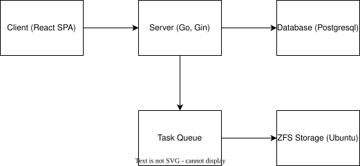

# KMEM – Experimental Personal Cloud Storage

> **Status: Prototype / Experimental**
> This project is an **experimental cloud file-server prototype** built to explore efficient media handling and async job design rather than full production reliability.

---

## Overview

KMEM is a lightweight **Go-based personal cloud storage** prototype.
It focuses on **file metadata design**, **media processing pipelines**, and **background workers** (thumbnails, cleanup, deduplication).

**Core idea:**
Instead of measuring throughput or RPS, this project concentrated on **how storage, queue, and async thumbnail generation** can be composed cleanly.

---

## Key Goals

| Focus Area                  | Description                                                                                   |
| --------------------------- | --------------------------------------------------------------------------------------------- |
| **Architecture Validation** | Verify modular separation (auth, upload, queue, cleanup) works under realistic I/O workloads. |
| **Media Pipeline**          | Integrate FFmpeg and Go routines for non-blocking thumbnail generation.                       |
| **Data Integrity**          | Test ZFS and SHA256-based duplicate detection.                                                |
| **Background Processing**   | Implement TTL/LRU caching, soft-delete cleanup, and worker queue reliability.                 |

---

## Tech Stack

* **Language**: Go 1.22
* **Framework**: Gin
* **Database**: PostgreSQL
* **Cache**: in-memory LRU + TTL
* **Media**: FFmpeg, FFprobe
* **Infra**: Docker + Docker Compose
* **Frontend**: React, Vite, TailwindCSS (for upload/gallery UI)

---

## System Architecture

<div align="center">
  
  <p><em>Figure. High-level prototype architecture (for concept validation only)</em></p>
</div>

---

## What’s Validated

* Upload → metadata → async thumbnail generation flow
* SHA256 duplicate detection (file-level deduplication)
* JWT auth, soft delete, scheduled cleanup
* Frontend + backend integration via Docker Compose

---

## Not Production-Ready (By Design)

* Security hardening (CORS, cookie flags, rate limiting)
* Failure handling & retries
* High-concurrency benchmarks / load testing
* Snapshot automation and large-scale backup

> *Performance benchmarking intentionally deferred*
> Because architecture and data layout were still evolving, early RPS results would not reflect real stability.

---

## Quick Start

```bash
# Environment
POSTGRES_PASSWORD=yourpass JWT_SECRET_KEY=jwtsecret docker-compose up

# Dev mode
./dev.sh

# Create account
curl -X POST -H "Content-Type: application/json" \
  -d '{"username": "test", "password": "test"}' \
  localhost:8000/auth/signup
```

* Frontend runs on [http://localhost:5173](http://localhost:5173)
* Backend API base: `http://localhost:8000`

---

## Sanity-Check Tests

| Scenario              | Expected Result                            |
| --------------------- | ------------------------------------------ |
| Upload image/video    | Thumbnail generated in background          |
| Re-upload same file   | Hash collision detected, duplicate skipped |
| Soft delete           | File hidden, removed later by cleanup job  |
| Invalid format upload | Rejected with validation error             |

---

## Future Work

* Bulk operations (tag, rename, delete)
* Metadata-based search / album system
* Auto-tagging using EXIF & AI models
* Progressive Web App (PWA) support
* CDN & caching for multi-device sync
* Redis cluster integration

---
